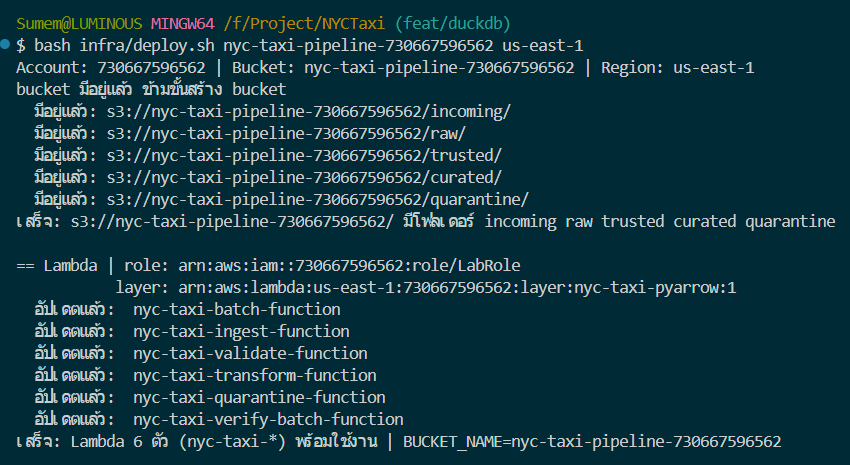
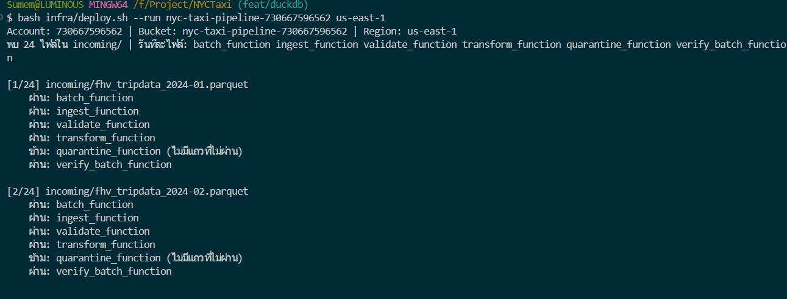
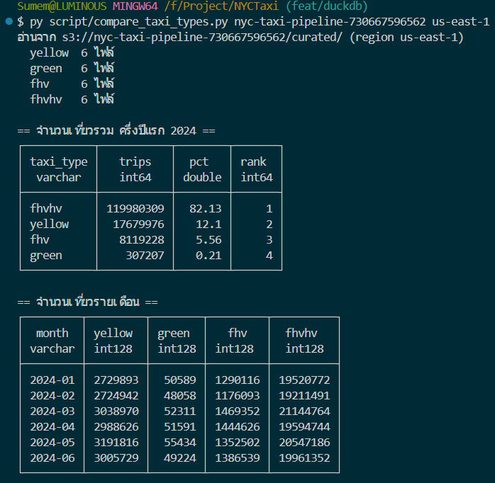
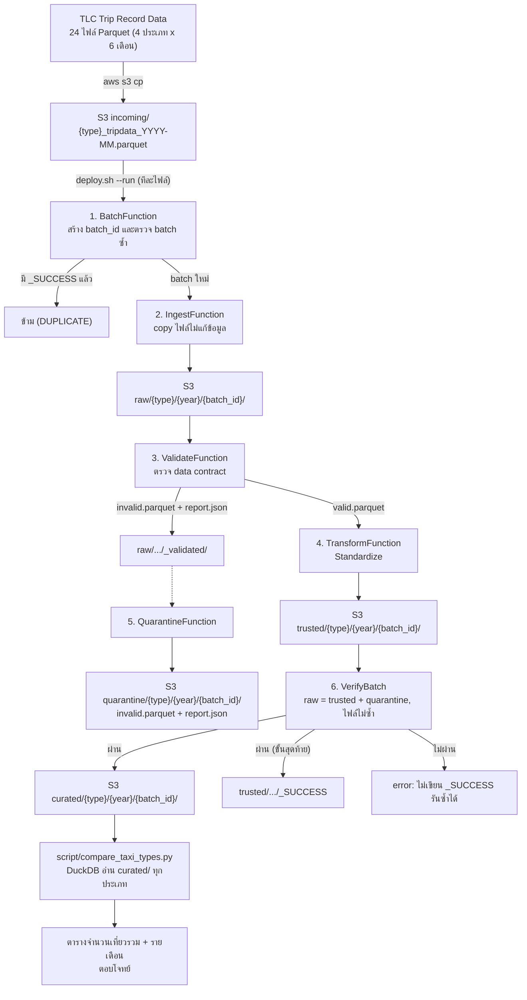

# NYC Taxi — Trip Records (ม.ค.–มิ.ย. 2024)

## สารบัญ

- [1. คำถาม](#1-คำถาม)
- [2. แหล่งที่มาข้อมูล](#2-แหล่งที่มาข้อมูล)
- [3. Schema ของ Parquet (Input)](#3-schema-ของ-parquet-input)
   - [3.1 Yellow (19 คอลัมน์)](#31-yellow-19-คอลัมน์)
   - [3.2 Green (20 คอลัมน์)](#32-green-20-คอลัมน์)
   - [3.3 FHV (7 คอลัมน์)](#33-fhv-7-คอลัมน์)
   - [3.4 FHVHV (24 คอลัมน์)](#34-fhvhv-24-คอลัมน์)
- [4. คู่มือการติดตั้งและวิธีรัน](#4-คู่มือการติดตั้งและวิธีรัน)
   - [4.1 สิ่งที่ต้องมี](#41-สิ่งที่ต้องมี)
   - [4.2 ตั้งค่า AWS CLI](#42-ตั้งค่า-aws-cli)
   - [4.3 Deploy (S3 + layer + Lambda)](#43-deploy-s3--layer--lambda)
   - [4.4 อัปโหลดข้อมูลและรัน pipeline](#44-อัปโหลดข้อมูลและรัน-pipeline)
   - [4.5 วิเคราะห์ผล](#45-วิเคราะห์ผล)
- [5. หลักฐานการรัน pipeline](#5-หลักฐานการรัน-pipeline)
- [6. ผลการวิเคราะห์](#6-ผลการวิเคราะห์)
- [7. Pipeline / Data Flow Diagram](#7-pipeline--data-flow-diagram)
- [8. ตัวอย่างชุดข้อมูลพร้อมใช้วิเคราะห์](#8-ตัวอย่างชุดข้อมูลพร้อมใช้วิเคราะห์)
- [9. การตัดสินใจสำคัญในการออกแบบ](#9-การตัดสินใจสำคัญในการออกแบบ)
- [10. Submission 2 พัฒนาจาก Submission 1 อย่างไร](#10-submission-2-พัฒนาจาก-submission-1-อย่างไร)
- [11. ข้อจำกัดของ pipeline ปัจจุบัน](#11-ข้อจำกัดของ-pipeline-ปัจจุบัน)
- [Learning Reflection](#learning-reflection)

## 1. คำถาม

**Which taxi type was the most used in the first half of 2024?**
(ประเภทแท็กซี่ใดถูกใช้มากที่สุดในครึ่งปีแรกของ 2024)


## 2. แหล่งที่มาข้อมูล

- **NYC Taxi & Limousine Commission (TLC) — Trip Record Data**
  https://www.nyc.gov/site/tlc/about/tlc-trip-record-data.page
- รูปแบบไฟล์: Parquet รายเดือน ตั้งชื่อ `{type}_tripdata_{YYYY-MM}.parquet`
- คำอธิบายฟิลด์ (Data Dictionary) อยู่ใน `docs/Dictionary/` (yellow, green, fhv, hvfhs)
- ไฟล์ข้อมูลอยู่ใน `data/{type}/` และโฟลเดอร์ `data/` ถูก ignore ด้วย `.gitignore`

| ประเภท | ความหมาย | จำนวนไฟล์ | เดือนที่มี | จำนวนแถวรวม |
|---|---|---|---|---|
| `yellow` | Yellow Taxi | 6 | 2024-01 ถึง 2024-06 | 20,332,093 |
| `green` | Green Taxi | **5** | 2024-01 ถึง 2024-05 (**ขาด 2024-06**) | 285,059 |
| `fhv` | For-Hire Vehicle | 6 | 2024-01 ถึง 2024-06 | 8,119,228 |
| `fhvhv` | High Volume For-Hire Vehicle (เช่น Uber, Lyft) | 6 | 2024-01 ถึง 2024-06 | 120,864,668 |

ตัวเลขแถวอ่านจาก metadata ของไฟล์ Parquet และ schema ของแต่ละประเภทเหมือนกันทุกเดือน

## 3. Schema ของ Parquet (Input)

### 3.1 Yellow (19 คอลัมน์)

| คอลัมน์ | ชนิด | คำอธิบาย |
|---|---|---|
| `VendorID` | `int32` | รหัสผู้ให้บริการระบบบันทึก trip |
| `tpep_pickup_datetime` | `timestamp[us]` | เวลารับผู้โดยสาร |
| `tpep_dropoff_datetime` | `timestamp[us]` | เวลาส่งผู้โดยสาร |
| `passenger_count` | `int64` | จำนวนผู้โดยสาร (คนขับกรอก) |
| `trip_distance` | `double` | ระยะทาง (ไมล์) |
| `RatecodeID` | `int64` | รหัสอัตราค่าโดยสาร |
| `store_and_fwd_flag` | `string` | Y/N ข้อมูลถูกเก็บในรถก่อนส่งหรือไม่ |
| `PULocationID` | `int32` | โซนรับ (TLC Taxi Zone) |
| `DOLocationID` | `int32` | โซนส่ง (TLC Taxi Zone) |
| `payment_type` | `int64` | วิธีชำระเงิน |
| `fare_amount` | `double` | ค่าโดยสารตามมิเตอร์ |
| `extra` | `double` | ค่าธรรมเนียมเพิ่มเติม |
| `mta_tax` | `double` | ภาษี MTA |
| `tip_amount` | `double` | ทิป |
| `tolls_amount` | `double` | ค่าทางด่วน |
| `improvement_surcharge` | `double` | ค่าธรรมเนียม improvement |
| `total_amount` | `double` | ยอดรวม |
| `congestion_surcharge` | `double` | ค่าธรรมเนียมความแออัด |
| `Airport_fee` | `double` | ค่าธรรมเนียมสนามบิน |

### 3.2 Green (20 คอลัมน์)

| คอลัมน์ | ชนิด | คำอธิบาย |
|---|---|---|
| `VendorID` | `int32` | รหัสผู้ให้บริการระบบบันทึก trip |
| `lpep_pickup_datetime` | `timestamp[us]` | เวลารับผู้โดยสาร |
| `lpep_dropoff_datetime` | `timestamp[us]` | เวลาส่งผู้โดยสาร |
| `store_and_fwd_flag` | `string` | Y/N ข้อมูลถูกเก็บในรถก่อนส่งหรือไม่ |
| `RatecodeID` | `int64` | รหัสอัตราค่าโดยสาร |
| `PULocationID` | `int32` | โซนรับ (TLC Taxi Zone) |
| `DOLocationID` | `int32` | โซนส่ง (TLC Taxi Zone) |
| `passenger_count` | `int64` | จำนวนผู้โดยสาร (คนขับกรอก) |
| `trip_distance` | `double` | ระยะทาง (ไมล์) |
| `fare_amount` | `double` | ค่าโดยสารตามมิเตอร์ |
| `extra` | `double` | ค่าธรรมเนียมเพิ่มเติม |
| `mta_tax` | `double` | ภาษี MTA |
| `tip_amount` | `double` | ทิป |
| `tolls_amount` | `double` | ค่าทางด่วน |
| `ehail_fee` | `double` | ค่าธรรมเนียม e-hail |
| `improvement_surcharge` | `double` | ค่าธรรมเนียม improvement |
| `total_amount` | `double` | ยอดรวม |
| `payment_type` | `int64` | วิธีชำระเงิน |
| `trip_type` | `int64` | ประเภท trip (street-hail / dispatch) |
| `congestion_surcharge` | `double` | ค่าธรรมเนียมความแออัด |

### 3.3 FHV (7 คอลัมน์)

| คอลัมน์ | ชนิด | คำอธิบาย |
|---|---|---|
| `dispatching_base_num` | `string` | เลข base ของ TLC ที่ dispatch trip |
| `pickup_datetime` | `timestamp[us]` | เวลารับผู้โดยสาร |
| `dropOff_datetime` | `timestamp[us]` | เวลาส่งผู้โดยสาร |
| `PUlocationID` | `int64` | โซนรับ (TLC Taxi Zone) |
| `DOlocationID` | `int64` | โซนส่ง (TLC Taxi Zone) |
| `SR_Flag` | `int64` | แฟล็ก shared ride (1 หรือ Null) |
| `Affiliated_base_number` | `string` | เลข base ที่คนขับ/รถสังกัด |

### 3.4 FHVHV (24 คอลัมน์)

| คอลัมน์ | ชนิด | คำอธิบาย |
|---|---|---|
| `hvfhs_license_num` | `string` | ใบอนุญาตผู้ให้บริการ (HV0002 Juno, HV0003 Uber, HV0004 Via, HV0005 Lyft) |
| `dispatching_base_num` | `string` | เลข base ที่ dispatch trip |
| `originating_base_num` | `string` | เลข base ที่รับคำขอเดินทาง |
| `request_datetime` | `timestamp[us]` | เวลาที่ผู้โดยสารขอเดินทาง |
| `on_scene_datetime` | `timestamp[us]` | เวลาที่คนขับถึงจุดรับ |
| `pickup_datetime` | `timestamp[us]` | เวลารับผู้โดยสาร |
| `dropoff_datetime` | `timestamp[us]` | เวลาส่งผู้โดยสาร |
| `PULocationID` | `int32` | โซนรับ (TLC Taxi Zone) |
| `DOLocationID` | `int32` | โซนส่ง (TLC Taxi Zone) |
| `trip_miles` | `double` | ระยะทาง (ไมล์) |
| `trip_time` | `int64` | เวลาเดินทาง (วินาที) |
| `base_passenger_fare` | `double` | ค่าโดยสารพื้นฐาน |
| `tolls` | `double` | ค่าทางด่วน |
| `bcf` | `double` | Black Car Fund |
| `sales_tax` | `double` | ภาษีขาย |
| `congestion_surcharge` | `double` | ค่าธรรมเนียมความแออัด |
| `airport_fee` | `double` | ค่าธรรมเนียมสนามบิน |
| `tips` | `double` | ทิป |
| `driver_pay` | `double` | ค่าตอบแทนคนขับ |
| `shared_request_flag` | `string` | Y/N ผู้โดยสารขอแชร์ |
| `shared_match_flag` | `string` | Y/N จับคู่แชร์สำเร็จ |
| `access_a_ride_flag` | `string` | Y/N trip ของโครงการ Access-A-Ride |
| `wav_request_flag` | `string` | Y/N ขอรถ wheelchair accessible |
| `wav_match_flag` | `string` | Y/N ได้รถ wheelchair accessible |

## 4. คู่มือการติดตั้งและวิธีรัน

### 4.1 สิ่งที่ต้องมี

| เครื่องมือ | ใช้ทำอะไร |
|---|---|
| Git Bash (Windows) หรือ bash บน Linux/macOS | รัน `infra/deploy.sh` |
| AWS CLI v2 | สร้าง S3 / Lambda และอัปโหลดไฟล์ |
| Python 3 + pip | สร้าง zip ของ Lambda, layer pyarrow และรันสคริปต์วิเคราะห์ |
| บัญชี AWS (AWS Academy Learner Lab) | ใช้ role `LabRole` และ region `us-east-1` |

### 4.2 ตั้งค่า AWS CLI

```bash
aws configure                                   # ใส่ Access Key, Secret Key จากหน้า AWS Details ของ Learner Lab
aws configure set aws_session_token <TOKEN>     # Learner Lab ต้องใช้ session token (หมดอายุทุก session)
aws configure set region us-east-1
aws sts get-caller-identity                     # ตรวจว่าเชื่อมต่อได้
```

### 4.3 Deploy (S3 + layer + Lambda)

```bash
git clone https://github.com/Rowbaine/NYC_Pipeline.git
cd NYC_Pipeline
bash infra/deploy.sh <BUCKET_NAME> us-east-1
```

- สร้าง bucket พร้อมโฟลเดอร์ `incoming/ raw/ trusted/ curated/ quarantine/`
- สร้าง layer `nyc-taxi-pyarrow` (pyarrow ที่รองรับ zstd) และ Lambda 6 ตัว `nyc-taxi-*`
- ไม่ใส่ `BUCKET_NAME` จะใช้ `nyc-taxi-pipeline-<AWS account id>` รันซ้ำได้ (มีอยู่แล้วจะข้าม/อัปเดต)

### 4.4 อัปโหลดข้อมูลและรัน pipeline

ดาวน์โหลดไฟล์ Parquet ม.ค.–มิ.ย. 2024 ทั้ง 4 ประเภทจาก TLC ไว้ใน `data/` แล้ว

```bash
aws s3 cp data/ s3://<BUCKET_NAME>/incoming/ --recursive --region us-east-1
bash infra/deploy.sh --run <BUCKET_NAME> us-east-1
```

`--run` รันทุกไฟล์ใน `incoming/` ทีละไฟล์ และสรุปผล `สำเร็จ / ข้าม / ล้มเหลว` ท้ายสุด

### 4.5 วิเคราะห์ผล

```bash
python -m pip install duckdb boto3
python script/compare_taxi_types.py <BUCKET_NAME> us-east-1
```

## 5. หลักฐานการรัน pipeline





## 6. ผลการวิเคราะห์



## 7. Pipeline / Data Flow Diagram



## 8. ตัวอย่างชุดข้อมูลพร้อมใช้วิเคราะห์

ชุดข้อมูลพร้อมใช้วิเคราะห์อยู่ที่ `s3://<bucket>/curated/{type}/{year}/{batch_id}/` (เฉพาะ batch ที่ผ่าน VerifyBatch แล้ว)
ตัวอย่างผลที่อ่านจากชุดข้อมูลนี้ด้วย DuckDB ดูที่ [ข้อ 6. ผลการวิเคราะห์](#6-ผลการวิเคราะห์)

## 9. การตัดสินใจสำคัญในการออกแบบ

| # | การตัดสินใจ | เหตุผล |
|---|---|---|
| 1 | แยกแต่ละขั้นของ pipeline เป็น Lambda คนละตัว (Batch, Ingest, Validate, Transform, Quarantine, VerifyBatch) และใช้ `deploy.sh --run` เรียกตามลำดับ | เมื่อมีการปรับเปลี่ยน แก้เฉพาะขั้นที่เกี่ยวข้องได้ ไม่กระทบขั้นอื่น ทำให้ดูแลง่ายและไม่ซับซ้อน |
| 2 | ใช้ DuckDB วิเคราะห์ข้อมูลใน `curated/` แทน Athena | ใช้งานได้เร็วและไม่มีค่าใช้จ่าย (Athena คิดเงินตามข้อมูลที่สแกน และต้องตั้ง Glue Catalog เพิ่ม) เหมาะกับโจทย์ที่ต้องการค่าสถิติ ไม่ต้องแก้ไขตารางมาก |

## 10. Submission 2 พัฒนาจาก Submission 1 อย่างไร

| | Submission 1 | Submission 2 |
|---|---|---|
| โครงสร้าง | ไฟล์ Python 1 ไฟล์ทำทุกอย่างใน pipeline | แยกเป็น Lambda 6 ตัวตามขั้นตอน และโมดูลกลาง `common/` |
| ที่เก็บข้อมูล | - | S3 แยกโซน `incoming/ raw/ trusted/ curated/ quarantine/` |
| คุณภาพข้อมูล | - | data contract แยกเป็นโมดูล (`script/data_contract/`) แถวที่ไม่ผ่านกฎ BLOCK ไป quarantine พร้อม `report.json` |
| การ deploy / รัน | - | `infra/deploy.sh` สร้าง S3, layer และ Lambda และสั่งรันด้วย `--run` |
| ความถูกต้องของ batch | - | VerifyBatch ตรวจจำนวนแถวและไฟล์ซ้ำก่อนเข้า curated |
| การวิเคราะห์ | - | DuckDB (`script/compare_taxi_types.py`) |

ข้อจำกัดที่ยังมีอยู่ดูที่ [ข้อ 11](#11-ข้อจำกัดของ-pipeline-ปัจจุบัน)

## 11. ข้อจำกัดของ pipeline ปัจจุบัน

- ยังรันแบบ parallel ไม่ได้ `deploy.sh --run` รันทีละไฟล์ตามลำดับ
- รันต่อจากขั้นที่ค้างไม่ได้ ถ้าระบบหยุดกลางคัน (เช่น batch เข้า `raw/` แล้วแต่ยังไม่ถึง transform) เมื่อรันใหม่ต้องเริ่ม batch นั้นใหม่ตั้งแต่ BatchFunction

## Learning Reflection
ใน sesion ที่ 2 หลังจากที่เราได้เรียนรู้การสร้าง Data pipeline เบื้องต้นก็ได้เข้าใจโครงสร้างการทำงานของ Pipeline และการลองสร้างครั้งแรก ถึงแม้ว่าจะไม่สมบูรณ์และต้องค่อยใช้ AI ช่วยในการทำระบบ ซึ่งในบางครั้งก็จำเป็นต้องค่อยตรวจการทำงานของ AI เพื่อให้ได้ผลลัพธ์ที่เราต้องการแต่ก็สามารถทดลองและสร้าง Pipeline ที่รันแบบ manual เบื้องต้นได้
